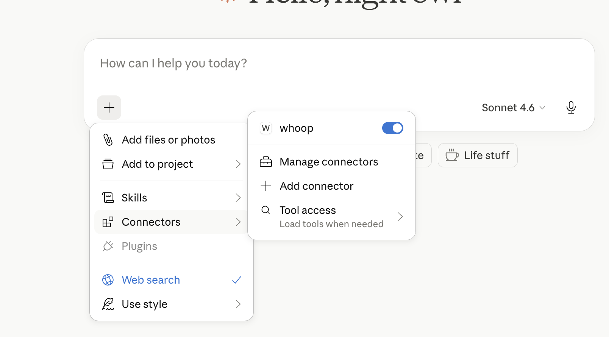
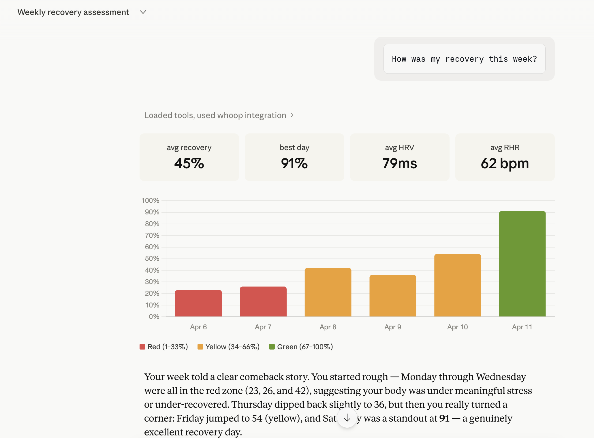

# Installation and Configuration

[Back to README](../README.md)

## Prerequisites

1. A [WHOOP](https://www.whoop.com/) account with an active membership
2. A WHOOP Developer App — create one at [developer.whoop.com](https://developer.whoop.com)
   - Register `http://localhost:3000/callback`, or the exact HTTP loopback URL
     configured with `WHOOP_REDIRECT_URI`.
3. [Node.js](https://nodejs.org/) >= 20, with npm, on the machine running the server
4. An MCP-capable client; tool, resource, prompt and remote-connector support varies

Collector/dashboard development needs Node >= 22. It is not required for normal npm use.

## Get a WHOOP

Don't have a WHOOP yet? Here's how to get started:

- 🛒 **Buy a WHOOP on Amazon** — [WHOOP peak on Amazon](https://amzn.to/4st9B2r)
- 🔗 **Join WHOOP directly** — [whoop.com/membership](https://join.whoop.com/63E6C805)

Hardware and membership are purchased separately; this package does not include
either and is not an official WHOOP product.

## Quickstart (MCP Registry)

Look up this server identity in the [MCP Registry](https://registry.modelcontextprotocol.io/)
when your client supports registry discovery. Check the returned package version;
an npm publication does not guarantee that registry metadata has refreshed:

```
Server name: io.github.shashankswe2020-ux/whoop
```

You can also browse it via the registry API:

```bash
curl "https://registry.modelcontextprotocol.io/v0.1/servers?search=io.github.shashankswe2020-ux/whoop"
```

## Quickstart (Claude Desktop)

Recommended: run the setup wizard, which asks for credentials and optional
telemetry consent (No by default):

```bash
npx -y whoop-ai-mcp@latest setup --client=claude-desktop
```

Or merge this entry into your existing Claude Desktop configuration file. Do not
replace other MCP servers or preferences. This manual example leaves telemetry off:

**macOS:** `~/Library/Application Support/Claude/claude_desktop_config.json`
**Windows:** `%APPDATA%\Claude\claude_desktop_config.json`

```json
{
  "mcpServers": {
    "whoop": {
      "command": "npx",
      "args": ["-y", "whoop-ai-mcp@latest"],
      "env": {
        "WHOOP_CLIENT_ID": "your_client_id",
        "WHOOP_CLIENT_SECRET": "your_client_secret"
      }
    }
  }
}
```

Replace `your_client_id` and `your_client_secret` with the credentials from your [WHOOP Developer App](https://developer.whoop.com).

Fully quit and reopen Claude Desktop. When the server starts without usable
cached tokens, it opens a browser for WHOOP authorization. Tokens are stored
locally and refreshed automatically. Confirm the WHOOP tool-use card in a new
chat; a natural-language answer alone does not prove the connector ran.

Then ask Claude something like:

> *"How am I doing today?"*
>
> *"Show me my sleep data from the last 3 days"*
>
> *"What workouts did I do this month?"*
>
> *"Is my HRV trending up or down?"*
>
> *"Give me a weekly health summary"*
>
> *"Show me my recovery calendar for last 2 weeks"*

**whoop-mcp connected in Claude Desktop:**

The screenshots below illustrate earlier Desktop versions; they are not current
telemetry or live health-status displays.



**Chatting with WHOOP data through Claude:**



**Weekly Health Report demo (Claude Desktop):**


## Installation

### Via npx (recommended)

No global installation is needed; npm downloads the package when your client
launches it. Use `whoop-ai-mcp@latest` to resolve npm's latest release when
launching. An already-running server does not update until restarted.

### Global install

```bash
npm install -g whoop-ai-mcp@latest
```

### From source

```bash
git clone https://github.com/shashankswe2020-ux/whoop-mcp.git
cd whoop-mcp
git checkout "v$(npm view whoop-ai-mcp@latest version)"
npm ci
npm run build
```

Point a local MCP client at the absolute path to `dist/index.js`, using your
Node executable as `command`. Normal server stdout is reserved for MCP messages.

### Setup wizard (`whoop-ai-mcp setup`)

For a guided installation that writes the Claude Desktop config, prints other
local client configurations, or explains remote connector requirements:

```bash
npx -y whoop-ai-mcp@latest setup
```

Flags:

- `--client=claude-desktop` (default) writes/merges `claude_desktop_config.json`
  with an automatic `.bak` backup.
- `--client=claude-code` prints the equivalent `claude mcp add` command.
- `--client=codex` prints the equivalent `codex mcp add` command (registers the
  server in `~/.codex/config.toml`).
- `--client=copilot` prints the equivalent `code --add-mcp` command for GitHub
  Copilot in VS Code.
- `--client=claude` aliases `claude-desktop`; `--client=vscode` aliases `copilot`.
- `--client=gemini-cli|cursor|openclaw` prints a config fragment to merge manually.
- `--client=perplexity` prints a launch command for the macOS app's local connector.
- `--client=claude-web|chatgpt|grok` prints remote guidance only; see below.
- `--verify` runs the OAuth flow end-to-end and fetches your profile to confirm
  everything is wired correctly before exiting.
- `--telemetry=on|off` explicitly sets optional usage telemetry. Interactive setup
  asks once when no decision is saved, defaulting to No. Non-interactive setup
  defaults off. `DO_NOT_TRACK=1` and aggregate privacy override consent.
- `--client-id` / `--client-secret` skip the interactive prompts (useful for
  scripts; prefer a secret manager or environment variables because command-line
  secrets can appear in shell history or process listings).

The wizard-generated launch entry uses `npx -y whoop-ai-mcp` (unversioned).
Use `whoop-ai-mcp@latest` to make the default npm tag explicit. For Claude Code,
Codex and Copilot, setup prints a command; it does not execute it. Review that
output privately because it contains your credentials.

If `WHOOP_CLIENT_ID` and `WHOOP_CLIENT_SECRET` are already exported in your
shell, the wizard uses them automatically without credential prompts. Combine with
`--verify` to do a one-shot config-correctness check:

```bash
npx -y whoop-ai-mcp@latest setup --client=claude-desktop --verify
```

If the Claude Desktop config file already contains a `whoop` MCP entry from
a previous setup, the wizard reuses the existing
credentials, prints `Existing whoop entry found in <path>`, and either
verifies them (with `--verify`) or skips verification. Interactive setup may add
a telemetry decision if none is saved; `--telemetry=on|off` updates that decision
while preserving the existing command, credentials and other settings. To
overwrite an existing entry, pass explicit `--client-id` / `--client-secret`
flags.

Precedence: `--client-id` / `--client-secret` flags > existing claude-desktop
config > `WHOOP_CLIENT_ID` / `WHOOP_CLIENT_SECRET` env vars > interactive
prompts.

For other supported clients:

```bash
npx -y whoop-ai-mcp@latest setup --client=claude-code
npx -y whoop-ai-mcp@latest setup --client=codex
npx -y whoop-ai-mcp@latest setup --client=copilot
```

The consent question is `Share this usage metadata? [y/N]:`. Only `y` or `yes`
enables it; blank input declines. A saved Desktop decision is reused. Explicit
opt-out and aggregate privacy take precedence, including updates to an enabled
Desktop entry. No token storage format is changed. `--verify` makes live WHOOP
requests and prints the returned profile; do not paste that output into public reports.

### Additional clients

Available in **npm 1.1.0+** and **Rust 0.2.0+**. Use
`npx -y whoop-ai-mcp@latest setup --client=<target>` or
`whoop-mcp setup --client=<target>`.
For an npm source checkout, run `npm run build`, then
`node dist/index.js setup --client=<target>`. The Rust checkout accepts
the same targets with `cargo run -- setup --client=<target>`.

| Client | Target | Setup result / limitation |
|---|---|---|
| Claude Desktop | `claude` or `claude-desktop` | Existing backup-and-merge wizard |
| Claude Code | `claude-code` | Existing registration command |
| ChatGPT | `chatgpt` | Remote HTTPS + compatible OAuth; developer mode/account/admin access required |
| Claude web/mobile | `claude-web` | Remote HTTPS custom connector + compatible OAuth |
| Grok | `grok` | xAI API remote MCP tool example, **not verified consumer Grok chat support** |
| Perplexity | `perplexity` | Local **macOS** app + PerplexityXPC helper; other platforms need remote connectors |
| Gemini CLI | `gemini-cli` | Merge `mcpServers.whoop` into `~/.gemini/settings.json` |
| Cursor | `cursor` | Merge `mcpServers.whoop` into `~/.cursor/mcp.json` |
| VS Code | `vscode` or `copilot` | `code --add-mcp` registration command |
| OpenClaw | `openclaw` | Merge `mcp.servers.whoop` in Settings > MCP; current native MCP support required |
| Codex | `codex` | Existing registration command; distinct from ChatGPT |

Local setup output contains secrets: review it privately, preserve existing
settings/servers when merging, restrict config permissions, and never commit it.
Printed shell commands use POSIX quoting (macOS/Linux, or a compatible shell);
do not paste them unchanged into PowerShell or cmd.exe. JSON fragments do not
require shell quoting. npm configurations require Node.js/npx on the client's
PATH. Rust configurations use the running binary's absolute path; that binary
must remain installed and accessible on the client host.

For Perplexity, install its helper, then use Plugins > Add custom > Simple,
name the server `whoop`, and paste the printed `env ...` launch command. Save,
wait for **Running**, then enable the connector under **Sources**. For OpenClaw,
the server runs on the **Gateway host**, which needs the binary/runtime and its
own WHOOP authorization. Validate with `openclaw mcp doctor whoop --probe`.
The native `mcp.servers` config is not the separate mcporter registry.

Remote targets deliberately skip credential and telemetry prompts, file writes,
and WHOOP API calls. They reject `--verify`, credential, config-path and telemetry
flags because those apply only to local setup. They do **not** deploy a server or
prove client compatibility. Use the [deployment guide](deployment.md) to provision
authenticated HTTPS and bootstrap the personal WHOOP token store first.

The existing OAuth connector registers **one static client**, default
`whoop-mcp-connector` (`MCP_OAUTH_CLIENT_ID`), with an exact
`ALLOWED_REDIRECT_URIS` allowlist. Configure the matching client ID in the
remote app where supported. A client requiring dynamic registration or another
OAuth flow may require server changes; this setup expansion does not add them.
Never disable authentication to work around a mismatch. Grok's xAI API can use
the existing HTTP bearer via its MCP tool's `authorization` field: use
`MCP_AUTH_TOKEN`, **not** a WHOOP access token or the separate xAI API key.
Every remote deployment serves one WHOOP account; do not share it as a
multi-user service.

Official client references (configuration verified against these docs; live
client/account connections are not certified by the setup unit tests):

- [Claude remote connectors](https://support.claude.com/en/articles/11175166-get-started-with-custom-connectors-using-remote-mcp)
- [ChatGPT custom MCP servers](https://help.openai.com/en/articles/12584461-connecting-custom-mcp-servers-in-chatgpt)
- [xAI remote MCP tools](https://docs.x.ai/developers/tools/remote-mcp)
- [Perplexity local and remote MCPs](https://www.perplexity.ai/help-center/en/articles/11502712-local-and-remote-mcps-for-perplexity)
- [Gemini CLI MCP configuration](https://geminicli.com/docs/tools/mcp-server/)
- [Cursor MCP configuration](https://cursor.com/docs/context/mcp)
- [VS Code MCP servers](https://code.visualstudio.com/docs/copilot/customization/mcp-servers)
- [OpenClaw native MCP configuration](https://docs.openclaw.ai/tools/mcp)

## Configuration

### Environment Variables

| Variable | Required | Description |
|----------|----------|-------------|
| `WHOOP_CLIENT_ID` | Yes | Your WHOOP Developer App client ID |
| `WHOOP_CLIENT_SECRET` | Yes | Your WHOOP Developer App client secret |
| `WHOOP_REDIRECT_URI` | No | WHOOP callback; default `http://localhost:3000/callback` |
| `WHOOP_MCP_PRIVACY_MODE` | No | `standard` (default) or `aggregate`; aggregate mode also disables telemetry |
| `WHOOP_MCP_DISABLE_RESOURCES` | No | `1` hides the four resources in standard mode |
| `WHOOP_MCP_TELEMETRY` | No | Only `1` opts in; absent or any other value disables sending |
| `WHOOP_MCP_TELEMETRY_ENDPOINT` | When opted in | Explicit HTTPS collector URL; setup supplies the maintainer URL after consent |
| `DO_NOT_TRACK` | No | `1` overrides all telemetry opt-ins |
| `MCP_TRANSPORT` | No | `stdio` (npm default), `http`, or `both`; Docker defaults to `http` |
| `MCP_AUTH_TOKEN` | HTTP/both | Strong bearer token protecting `/mcp`; required even with connector OAuth |
| `MCP_HOST` | No | HTTP bind address, default `0.0.0.0` |
| `MCP_PORT` | No | HTTP listen port, default `3000` |
| `MCP_ALLOWED_ORIGINS` | No | Comma-separated exact CORS origins; unset grants no browser origin |
| `MCP_TRUST_PROXY` | No | `1` trusts forwarded client IPs; only behind a trusted proxy |
| `LOG_LEVEL` | No | `debug`, `info` (default), `warn`, or `error` |
| `LOG_FORMAT` | No | `json` (default) or `pretty`; operational logs go to stderr |
| `MCP_CONNECTOR_PASSWORD` | Connector OAuth | At least 12 characters; separate from WHOOP credentials |
| `PUBLIC_URL` | Connector OAuth | Public HTTPS origin of your personal MCP host |
| `ALLOWED_REDIRECT_URIS` | Connector OAuth | Comma-separated exact assistant callback URLs |
| `MCP_JWT_SECRET` | No | Connector signing key override; otherwise derived from `MCP_AUTH_TOKEN` using HKDF |
| `MCP_OAUTH_CLIENT_ID` | No | Connector client identifier; default `whoop-mcp-connector` |

Set these in your Claude Desktop config (see [Quickstart](#quickstart-claude-desktop)) or as shell environment variables:

```bash
export WHOOP_CLIENT_ID=your_client_id
export WHOOP_CLIENT_SECRET=your_client_secret
```

The executable does not automatically load `.env` files. Export variables, use
the client's `env` object, or supply `--env-file` to Docker. Restart the MCP
process after changes. Running `telemetry status` in a shell reports that shell's
environment, not an already-running Desktop connector's configuration.

`WHOOP_REDIRECT_URI` must use HTTP and `localhost`, `127.0.0.1`, or `[::1]`,
with no credentials, query or fragment. Its port must be 1-65535; custom paths
and ports configure the actual listener. Register the exact URL with WHOOP.
`ALLOWED_REDIRECT_URIS` instead controls assistant-to-host connector OAuth.

### Creating a WHOOP Developer App

1. Go to [developer.whoop.com](https://developer.whoop.com)
2. Create a new application
3. Set the **Redirect URI** to `http://localhost:3000/callback`
4. Provide a **Privacy Policy URL** accurately describing your deployment's WHOOP
  data handling, assistant-provider sharing and optional telemetry
5. Enable the following scopes:
   - `read:profile`
   - `read:recovery`
   - `read:sleep`
   - `read:workout`
   - `read:cycles`
   - `read:body_measurement`
6. Copy the **Client ID** and **Client Secret**

The authorization request also includes `offline` for refresh tokens. Keep
credentials private; each deployment authenticates one WHOOP account, not every
user of a shared assistant service.

## Authentication

`whoop-ai-mcp` uses OAuth2 Authorization Code flow with PKCE:

1. **First run:** A browser window opens for you to authorize with WHOOP
2. **Token caching:** Access and refresh tokens are saved to `~/.whoop-mcp/tokens.json`
3. **Auto-refresh:** When the access token expires, it's automatically refreshed using the stored refresh token
4. **Re-authentication:** A rejected or expired refresh token may require browser authorization again

Token files use `0600` and the token directory uses `0700` on POSIX systems.
The `offline` scope enables refresh tokens. A transient refresh network failure
is reported for retry rather than automatically forcing browser reauthorization.
Avoid concurrent deployments sharing one token file; refresh-token rotation can
invalidate another process's saved credentials.
